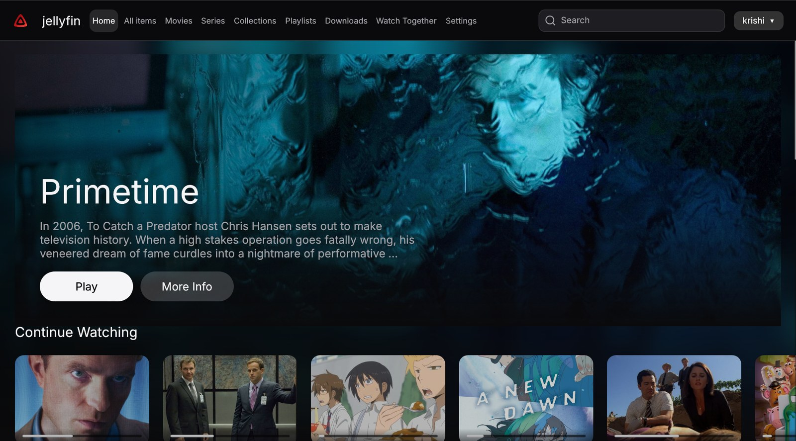
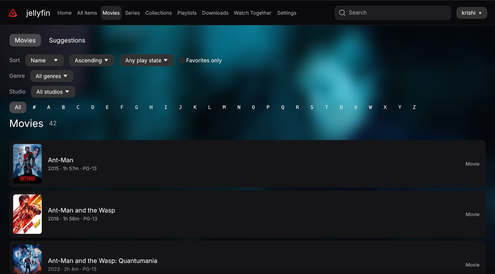
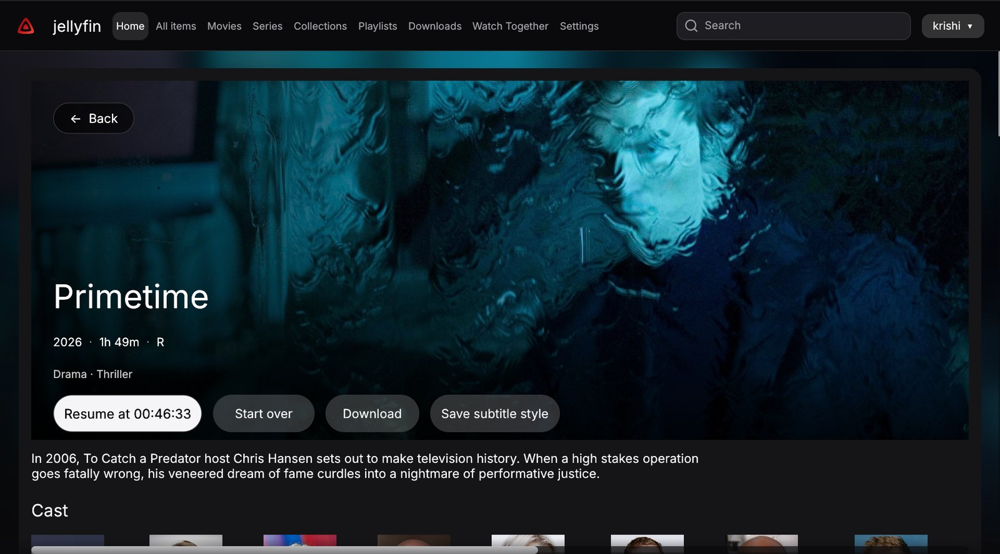
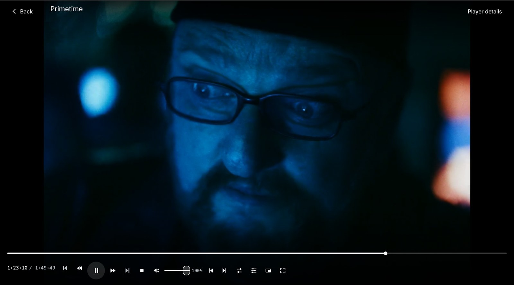
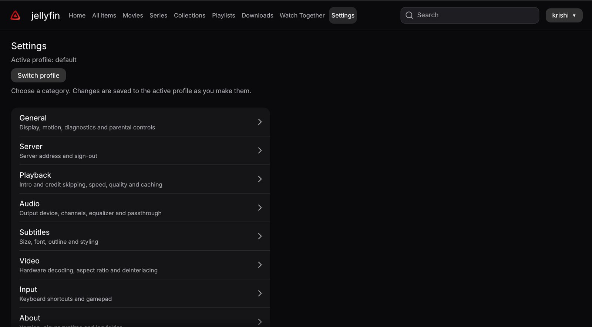

<p align="center">
  
</p>

<h1 align="center">jellyfin kattri</h1>

<p align="center">
  <a href="https://github.com/Archerkattri/jellyfin-kattri/actions/workflows/rust-client-ci.yml"></a>
  <a href="https://github.com/Archerkattri/jellyfin-kattri/releases"></a>
  <a href="LICENSE"></a>
</p>

<p align="center">A fast, native desktop client for Jellyfin. Built in Rust with egui and
libmpv: no web view, no JavaScript UI, no server changes.</p>

Kattri connects to your Jellyfin server like any other client and plays your library in a
real desktop window, with a keyboard, a gamepad or a mouse.



## Why Kattri

- **Native all the way down.** The interface is rendered by egui on an OpenGL surface and
  video is decoded by libmpv into the same window. No bundled browser, no second UI stack,
  no web-app memory footprint.
- **Your credentials stay yours.** libmpv never receives a token or your server URL. It
  plays a session-scoped loopback relay URL bound to one origin. Remembered sign-ins live
  in the operating-system credential store, not in a settings file.
- **Negotiates playback.** Kattri evaluates DirectPlay, DirectStream and Transcode against
  its device profile and the runtime libmpv inventory, with bounded source fallback when
  playback fails.
- **Made for a couch and a desk.** Hero artwork, poster rows and focus animation, driven by
  keyboard, gamepad or mouse, with Standard, Large and 10-foot interface sizes.

## Screenshots

| Movies library | Item details |
| --- | --- |
|  |  |

| Player | Settings |
| --- | --- |
|  |  |

These are framebuffer captures from the running application against a real Jellyfin 12.4.0
server, produced by `scripts/qa_clickthrough.ps1` on 2026-10-30. No mock data is used.

## Features

| | |
| --- | --- |
| **Sign-in** | Password sign-in, Quick Connect, saved servers, LAN discovery, multiple profiles, stay signed in, forgot-password flow |
| **Home** | Continue Watching, Next Up, Latest, My Media and Collections shelves, hero banner, per-section visibility and ordering, optional combined Continue Watching/Next Up shelf, local show hiding |
| **Library** | Paging, sorting, play state, favorites, genre and studio filters, alphabet picker, poster grid or list, adjustable poster size, 1,000-item photo grids, music All/Albums/Songs views, and Jellyfin-style tabs: Suggestions for movies, plus Upcoming and Episodes for shows |
| **Details** | Metadata, overview, cast, similar titles, seasons and episodes, series Next Up, media info, version picker, trailers and extras, lyrics, theme media, play and download |
| **Search** | Debounced cross-type search grouped by movies, series, episodes, music, playlists, photos, people and channels; subtitle search |
| **Playback** | Direct play, direct stream and transcode through the relay; resume with optional rewind; playback reporting; audio and subtitle tracks; subtitle delay; subtitle burn-in for transcodes; chapters; speed; segment skip; bounded mid-stream recovery |
| **Player** | Transport bar, 10-second seek, frame step, chapter step and menu, volume and mute, speed, A-B loop, picture-in-picture, fullscreen; previous/next; Up Next card and auto-play; fullscreen mouse-wheel seek (`Ctrl+1` 1:1 window, `Ctrl+2` 2x speed); track menus; media info (`I`); equalizer and loudness filters; HDR-to-SDR tone mapping; refresh-rate matching on Windows; open a stream address |
| **Music** | Album and playlist browsing, queue with shuffle and repeat, queue restored after restart, Download all for an album |
| **Live TV** | Channel list, 24-hour guide, tune through the relay, record the current program, recordings and scheduled recordings |
| **Offline** | Download manager with pause, resume, range fallback, checksum verification and external subtitles |
| **Extras** | Item menu (play, mark watched, favorite, download, add to playlist or queue), multi-select toolbar with bulk watched/favorite/queue/download, playlists, collections, favorites, photo slideshow, admin-lite dashboard, parental PIN |
| **Administration** | Edit metadata, Identify, Edit images, Add to collection, Refresh metadata and confirmed Delete; administrator user listing, creation, rename and access-policy editing with confirmation |
| **Settings** | General, playback, audio, subtitles (style, per-title overrides, burn-in), video, input, server (private CA and client certificate), About; versioned TOML per profile |
| **Input** | Rebindable keyboard map, gamepad menus and player control, full focus navigation, optional Windows-wide playback shortcuts (Ctrl+Alt+Space / Left / Right / M) |
| **Interface** | Dark-only Jellyfin Dark and Warm Dark themes (saved Light/System values load as Jellyfin Dark) with optional custom accent, background and surface colors; SF Pro Display typeface (Inter fallback); ambient backdrops with poster fallback, optional local backdrop, reduced-motion support, Standard/Large/TV sizes, narrow-window More menu, idle screensaver, cursor auto-hide in fullscreen |

## Install

Download the installer for your platform from the
[releases page](https://github.com/Archerkattri/jellyfin-kattri/releases). The current
prerelease is **v0.7.0**.

| Platform | Download | Notes |
| --- | --- | --- |
| Windows x64 | `JellyfinKattri-0.7.0-x64.msi` or `-x64-portable.zip` | libmpv is bundled; the portable zip runs `jellyfin-kattri.exe` |
| Windows ARM64 | `JellyfinKattri-0.7.0-arm64.msi` or `-arm64-portable.zip` | libmpv is bundled |
| macOS (universal) | `kattri-0.7.0-macos-universal.dmg` | libmpv is bundled; ad-hoc signed |
| Linux x64 | `kattri_0.7.0-1_amd64.deb`, `kattri-0.7.0-1.x86_64.rpm`, `kattri-0.7.0-linux-x64.AppImage`, `kattri-0.7.0-linux-x64.flatpak` | deb/rpm use the distro libmpv; AppImage and Flatpak bundle it |

Every download has a matching `.sha256` file. The release also publishes
`kattri-sbom.json`, `binary-audit.json` and a reproducible-build record.

```sh
# Debian / Ubuntu (needs libmpv2 or libmpv1 installed)
sudo apt install ./kattri_0.7.0-1_amd64.deb

# Fedora (needs libmpv)
sudo dnf install ./kattri-0.7.0-1.x86_64.rpm

# AppImage, no install needed
chmod +x kattri-0.7.0-linux-x64.AppImage
./kattri-0.7.0-linux-x64.AppImage

# Flatpak
flatpak install --user --bundle kattri-0.7.0-linux-x64.flatpak
```

Windows SmartScreen and macOS Gatekeeper will warn because the packages are not
code-signed. The macOS app is ad-hoc signed and not notarized. Code signing needs an owner
certificate and is not part of this prerelease.

### System requirements

| Platform | Requirement |
| --- | --- |
| Windows x64 / ARM64 | Windows 10 (1809) or Windows 11; OpenGL 3.3 capable GPU driver |
| macOS | macOS 13 or newer; Apple Silicon or Intel (universal); OpenGL 4.1 |
| Linux x64 | glibc 2.35 or newer (Ubuntu 22.04+, Debian 12+, Fedora 36+); X11 or Wayland through XWayland; OpenGL 3.3 |
| All | About 300 MB of disk for the bundled libmpv build; a Jellyfin 10.9+ server |

### First run

1. Enter your server address. Plain HTTP is accepted for loopback and private-network
   addresses; public servers must use HTTPS unless you explicitly allow otherwise.
2. Sign in with a password or Quick Connect. "Stay signed in" keeps the access token in the
   OS credential store.
3. Use `--profile <name>` to keep separate settings and queues for another profile.

Settings, profiles and logs live in the platform config directory; the About screen shows
the exact log folder. `KATTRI_LOG` overrides the log level for one run. Logs redact
credentials and server addresses and are never uploaded.

## Keyboard and gamepad

Every action can be rebound in Settings → Input. A gamepad can drive menus and the player.

| Action | Keys |
| --- | --- |
| Navigate | Arrow keys or `W` `A` `S` `D` |
| Confirm / back | `Enter` · `Esc`, `Backspace` |
| Home / search / settings | `H` · `Ctrl+F` · `M` |
| Play, pause, stop | `Space` or `P` · `Ctrl+P` · `X` |
| Seek and step | `PgUp` / `PgDn` · `Home` / `End` |
| Audio, subtitles, mute | `E` / `Ctrl+A` · `L` / `Ctrl+L`, `C` · `N` |
| Volume and speed | `=` / `-` · `Ctrl+Up` / `Ctrl+Down` |
| Subtitle delay | `Alt+S` / `Alt+Shift+S`, reset with `Alt+R` |
| Fullscreen, screenshot, close | `F11` · `Ctrl+S` · `Ctrl+Q` |

## Security and privacy

- Access tokens are zeroized in memory and stored only in the OS credential store, bound to
  the profile, server and exact base address.
- The playback relay listens on loopback only, uses a random capability, enforces the
  upstream origin, refuses redirects and copies only allow-listed response headers.
- JSON, image, manifest and stream inputs are bounded; logs and error messages are redacted.
- Remote plain HTTP requires an explicit opt-in. No telemetry is collected.
- A source security review for this release, including its accepted risks, is kept with the
  project's private documentation.

## Status and limitations

Kattri is a prerelease, not a 1.0 release. The build and test workflows pass for the v0.7.0
head on Windows x64/ARM64, macOS and Linux x64/ARM64; the default workspace suite runs more
than 3,100 tests against local fixtures and an in-process mock Jellyfin server.

Validated so far:

- Real-server browsing against Jellyfin 12.x: sign-in, Home rows, libraries, item details,
  search, people, similar items and PlaybackInfo negotiation.
- Stream-only playback through the relay on Windows x64: a 10-minute DirectPlay run and a
  30-second Transcode run with software/null outputs.
- A Windows x64 native-window DirectPlay check on November 2: decoded video was visible,
  pause and seek changed the real player, and stop returned to browsing.
- A Windows RTX 4060 run using NVDEC with an HDR10 source tone-mapped to SDR.
- Packaging: release artifacts for every platform. Clean-runner install, launch and normal
  close pass for the macOS DMG and all four Linux formats.

Not yet validated: visible and audible playback on macOS and Linux, GPU decode across
hardware, HDR passthrough, long HLS sessions, SyncPlay with two clients, physical
controllers, and screen-reader walks on each platform. The Windows MSI clean-runner check
proves install, window creation, normal close and clean uninstall, not OpenGL rendering,
which the GPU-less runners cannot provide.

Known gaps: in-app automatic updates (the signed fetch and apply path is built, but no
update host is configured and the release keyring is empty, so updates are manual), code
signing and notarization, Microsoft Store and Flathub distribution, native macOS window
menus and Wayland refresh-rate switching, and synchronized lyrics. Theme media plays on
request from the item page rather than automatically as ambient audio.

## Troubleshooting

- **"libmpv could not be loaded"**: the portable Windows zip needs `libmpv-2.dll` beside
  `jellyfin-kattri.exe`; the MSI and the macOS/Linux bundles include it. For a source build,
  put it beside the executable or on `PATH`.
- **A blank window or a GL error**: the client needs OpenGL 3.3 or newer. Update the GPU
  driver or switch off a remote-desktop session that lacks OpenGL.
- **SmartScreen or Gatekeeper warning**: the packages are unsigned for this prerelease.
  Verify the `.sha256` file before running.
- **Login fails on a private CA**: add the CA bundle in Settings → Server; client
  certificates are supported for mutual TLS.
- **Nothing plays**: check the server's transcode settings and the log folder shown in
  About. `KATTRI_LOG=debug` raises log detail for one run.

## Build from source

Install Rust through rustup; the toolchain is pinned in `rust-toolchain.toml` and
dependencies in `Cargo.lock`.

```sh
cargo build --workspace --locked
cargo run --locked -p egui-gl-host-proof --bin jellyfin-kattri
```

The executable is `jellyfin-kattri`. libmpv is loaded at run time, so it is not needed to
build.

```sh
# Linux: gamepad input headers, X11 keyboard library and libmpv
sudo apt-get install pkg-config libudev-dev libxkbcommon-x11-0 libmpv2

# macOS: a libmpv build; the packaged app carries its own
brew install mpv

# Windows: place libmpv-2.dll beside jellyfin-kattri.exe or on PATH
```

## Development checks

The default suite needs no server, libmpv, display or stored credentials.

```sh
cargo fmt --all -- --check
cargo clippy --workspace --all-targets --locked -- -D warnings
cargo test --workspace --locked
```

The full gate also runs credential-helper, live-runner, release-target, development
runtime-selection and offline QA-harness checks:

```powershell
powershell -NoProfile -ExecutionPolicy Bypass -File scripts/check.ps1
```

The automated click-through QA drives the real window through Windows UI Automation, clicks
every top-level page and settings category, opens item details and the player, and checks
accessible state changes before recording screenshots. It requires an interactive desktop, a
debug build and locally encrypted test credentials. Set `JELLYFIN_TEST_URL` explicitly for a
nonloopback test server; playback runs in stream-only mode with session reporting disabled:

```powershell
powershell -NoProfile -ExecutionPolicy Bypass -File scripts/qa_clickthrough.ps1
```

Live-server tests are opt-in and ignored by default; point them at a test server with
`JELLYFIN_TEST_URL`, `JELLYFIN_TEST_USER` and `JELLYFIN_TEST_PASSWORD`. Never commit
credentials, tokens or live output.

Windows development QA can resolve architecture-matching libmpv from `KATTRI_LIBMPV_DIR`,
beside the executable, or a private `.local/libmpv/` installation. Keeping the runtime
outside `target/` lets it survive `cargo clean`. No runtime binary is downloaded by the QA
launcher.

Windows and Linux packages register Kattri-specific links of the form
`jellyfin://kattri/v1/item/<item-guid>?server=<percent-encoded-server-base>`. Links prefill
the server and require manual sign-in before opening details; they never carry credentials
or start playback automatically. This is not a universal link format shared by all Jellyfin
clients.

## Contributing

Issues and pull requests are welcome. Run the development checks above before sending a
change; formatting, strict Clippy and the workspace tests must pass. Release history is in
[CHANGELOG.md](CHANGELOG.md).

## License

GPL-3.0-only. See `LICENSE` and `NOTICE`. The bundled Inter typeface is under the SIL Open
Font License (`assets/fonts/OFL.txt`). Bundled native libraries and codecs keep their own
licenses; the libmpv packaging notice is under `packaging/libmpv/NOTICE.txt`. Jellyfin
Kattri is an independent client and is not affiliated with the Jellyfin project.
