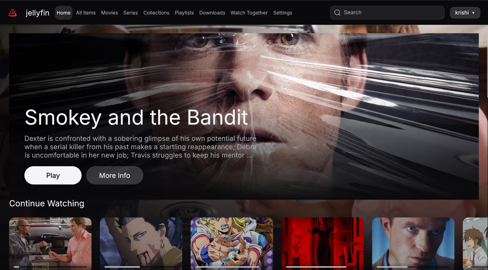
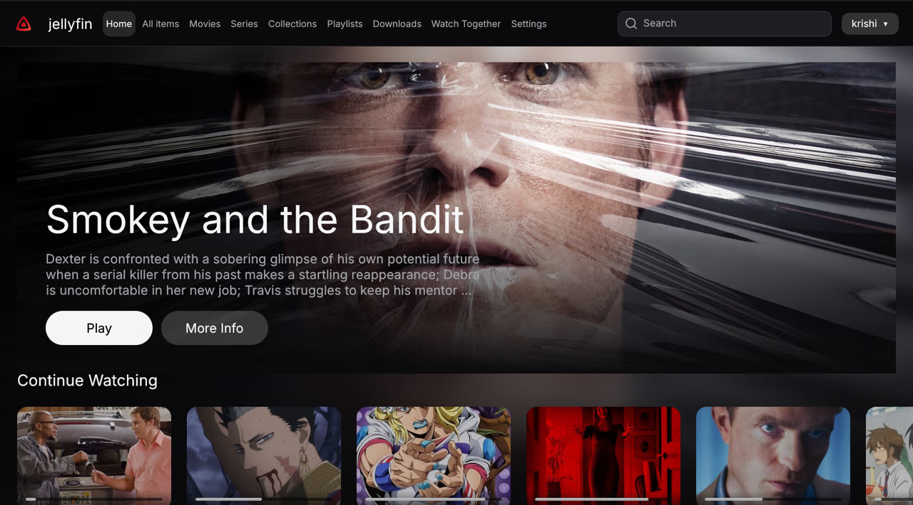
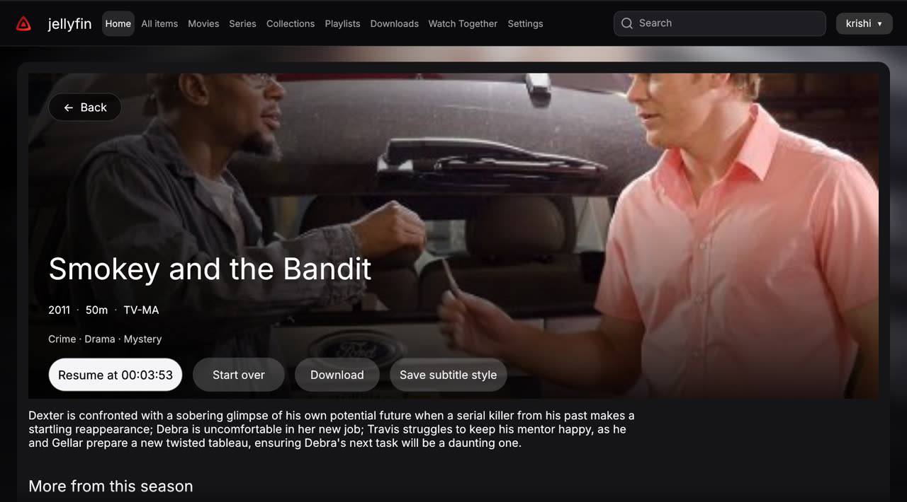
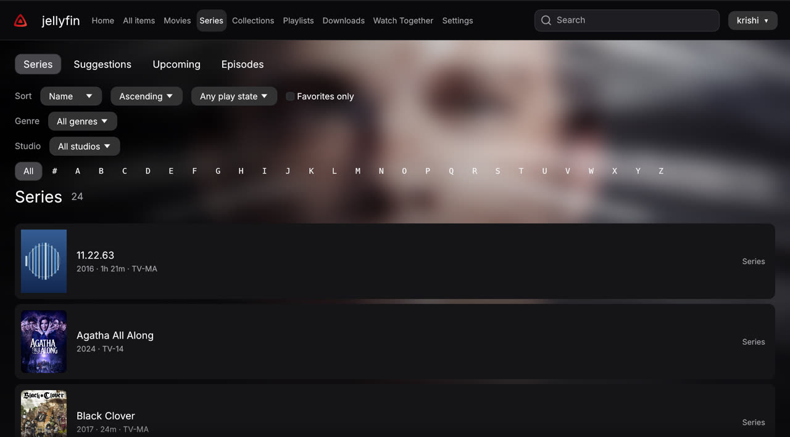
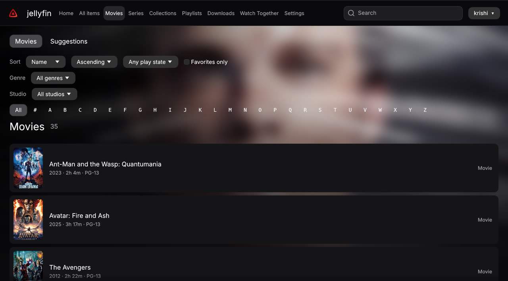
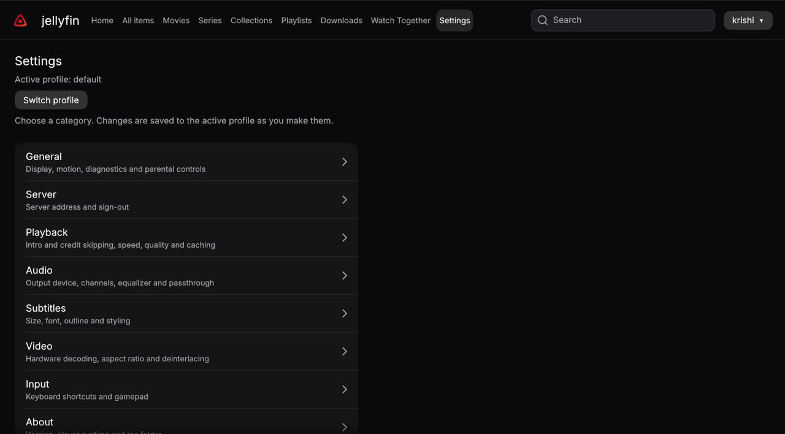

<p align="center">
  
</p>

<h1 align="center">jellyfin kattri</h1>

<p align="center">
  <a href="https://github.com/Archerkattri/jellyfin-kattri/actions/workflows/rust-client-ci.yml"></a>
  <a href="https://github.com/Archerkattri/jellyfin-kattri/releases"></a>
  <a href="LICENSE"></a>
</p>

<p align="center">A fast, native desktop client for Jellyfin. Built in Rust with egui and
libmpv: no web view, no JavaScript UI, no server changes.</p>

Kattri connects to your Jellyfin server like any other client and plays your library in a
real desktop window, with a keyboard, a gamepad or a mouse.



## Why Kattri

- **Native all the way down.** The interface is rendered by egui on an OpenGL surface and
  video is decoded by libmpv into the same window. No bundled browser, no second UI stack,
  no web-app memory footprint.
- **Your credentials stay yours.** libmpv never receives a token or your server URL. It
  plays a session-scoped loopback relay URL bound to one origin. Remembered sign-ins live
  in the operating-system credential store, not in a settings file.
- **Negotiates playback.** Kattri evaluates DirectPlay, DirectStream and Transcode against
  its device profile and the runtime libmpv inventory, with bounded source fallback when
  playback fails.
- **Made for a couch and a desk.** Hero artwork, poster rows and focus animation, driven by
  keyboard, gamepad or mouse, with Standard, Large and 10-foot interface sizes.

## Performance vs Jellyfin Desktop

A native client should feel lighter than a web-stack one. These figures come from driving Kattri
and the official Jellyfin Desktop against the **same Jellyfin server and the same episode** on
Windows x64.


[Watch the 4K version (MP4, 8 MB, 13 s)](assets/benchmark/kattri-vs-desktop.mp4)

The clip is generated from code (Remotion with Three.js and GSAP): a single Jellyfin Kattri mark
carries the whole sequence, moving from the opening to the corner of the comparison and back. The
inline GIF is a 1080p loop; the linked file is 3840×2160.

| Metric | Kattri | Jellyfin Desktop |
| --- | --- | --- |
| Time to ready (launch → signed in & browsing) | ~0.7 s | ~6.2 s |
| Memory while playing (working set) | ~0.40 GB | ~0.93 GB |
| Processes | 1 | 2 |

Measured with a server-driven harness (launch → session visible → remote PlayNow), medians over
repeated runs. Time-to-ready and memory are consistent wins; time from a play command to first
frame is comparable between the two and is not claimed as a win. Numbers vary with server and
network conditions; treat them as representative, not a guarantee.

## Screenshots

| Movies and series | Item details |
| --- | --- |
|  |  |

| Player | Settings |
| --- | --- |
|  |  |

| Series | All items |
| --- | --- |
|  |  |

These are framebuffer captures from the running application against a real Jellyfin 12.4.0
server on 2026-11-17, with the debug-only stream-only banner cropped out. No mock data is
used.

## Features

| | |
| --- | --- |
| **Sign-in** | Password sign-in, Quick Connect, saved servers, LAN discovery, separate settings profiles per `--profile`, stay signed in, forgot-password flow |
| **Home** | Continue Watching, Next Up, Latest, My Media and Collections shelves, hero banner, per-section visibility and ordering, optional combined Continue Watching/Next Up shelf, local show hiding |
| **Library** | Paging, sorting, play state, favorites, genre and studio filters, alphabet picker, poster grid or list, adjustable poster size, 1,000-item photo grids, music All/Albums/Songs views, and Jellyfin-style tabs: Suggestions for movies, plus Upcoming and Episodes for shows |
| **Details** | Metadata, overview, cast, similar titles, seasons and episodes, series Next Up, media info, version picker, trailers and extras, synchronized lyrics for the playing track, theme media, play and download |
| **Search** | Debounced cross-type search grouped by movies, series, episodes, music, playlists, photos, people and channels; subtitle search |
| **Playback** | Direct play, direct stream and transcode through the relay; resume with optional rewind; playback reporting; audio and subtitle tracks; subtitle delay; subtitle burn-in for transcodes; chapters; speed; segment skip; bounded mid-stream recovery |
| **Player** | Transport bar, 10-second seek, frame step, chapter step and menu, volume and mute, speed, A-B loop, picture-in-picture, fullscreen; previous/next; Up Next card and auto-play; fullscreen mouse-wheel seek (`Ctrl+1` 1:1 window, `Ctrl+2` 2x speed); track menus; media info (`I`); equalizer and loudness filters; HDR-to-SDR tone mapping; refresh-rate matching on Windows; open a stream address |
| **Music** | Album and playlist browsing, queue with shuffle and repeat, queue restored after restart, Download all for an album |
| **Live TV** | Channel list, 24-hour guide, tune through the relay, record the current program, recordings and scheduled recordings |
| **Offline** | Download manager with pause, resume, range fallback, checksum verification and external subtitles |
| **Extras** | Item menu (play, mark watched, favorite, download, add to playlist or queue), multi-select toolbar with bulk watched/favorite/queue/download, playlists, collections, favorites, photo slideshow, admin-lite dashboard, parental PIN |
| **Administration** | Edit metadata, Identify, Edit images, Add to collection, Refresh metadata and confirmed Delete; administrator user listing, creation, rename and access-policy editing with confirmation |
| **Settings** | General, playback, audio, subtitles (style, per-title overrides, burn-in), video, input, server (private CA and client certificate), About; versioned TOML per profile |
| **Input** | Rebindable keyboard map, gamepad menus and player control, full focus navigation, optional Windows-wide playback shortcuts (Ctrl+Alt+Space / Left / Right / M) |
| **Interface** | Two dark themes, Jellyfin Dark and Warm Dark (saved Light/System values load as Jellyfin Dark); optional custom accent, background and surface colors; bundled Inter typeface; ambient backdrops with poster fallback, optional local backdrop, reduced-motion support, Standard/Large/TV sizes, narrow-window More menu, idle screensaver, cursor auto-hide in fullscreen |

## Install

Download the installer for your platform from the
[releases page](https://github.com/Archerkattri/jellyfin-kattri/releases). The current
release is **v1.0.1**.

| Platform | Download | Notes |
| --- | --- | --- |
| Windows x64 | `JellyfinKattri-1.0.1-x64.msi`, `JellyfinKattri-1.0.1-x64-portable.zip` | libmpv is bundled |
| Windows ARM64 | `JellyfinKattri-1.0.1-arm64.msi`, `JellyfinKattri-1.0.1-arm64-portable.zip` | libmpv is bundled |
| Windows (universal) | `JellyfinKattri-1.0.1-universal.msi` | One installer carries x64 and ARM64 payloads |
| macOS (universal) | `kattri-1.0.1-macos-universal.dmg`, `JellyfinKattri-1.0.1.pkg` | Universal arm64 + x86_64 app; ad-hoc signed, not notarized |
| Linux x64 | `kattri_1.0.1-1_amd64.deb`, `kattri-1.0.1-1.x86_64.rpm`, `kattri-1.0.1-linux-x64.AppImage`, `kattri-1.0.1-linux-x64.flatpak`, `JellyfinKattri-1.0.1-linux.run` | The deb/rpm, AppImage, Flatpak and `.run` include libmpv; distro-native dependencies are declared by the deb/rpm |

Linux ARM64 has CI build/test coverage but no published release package.

Verify downloaded files against checksum sidecars when they are published with the release; otherwise compute a local digest and compare it with a separately trusted value. Do not assume a `SHA256SUMS` manifest is attached. SBOM and asset-binding evidence may be uploaded separately as a GitHub Actions artifact; no reproducible-build record is published with the release.

```sh
# Debian / Ubuntu
sudo apt install ./kattri_1.0.1-1_amd64.deb

# Fedora
sudo dnf install ./kattri-1.0.1-1.x86_64.rpm

# AppImage, no install needed
chmod +x kattri-1.0.1-linux-x64.AppImage
./kattri-1.0.1-linux-x64.AppImage

# Flatpak
flatpak install --user --bundle kattri-1.0.1-linux-x64.flatpak
```

Windows SmartScreen and macOS Gatekeeper will warn because the packages are not
code-signed. The macOS app is ad-hoc signed and not notarized. Code signing needs an owner
certificate and is not part of this release.

### System requirements

| Platform | Requirement |
| --- | --- |
| Windows x64 / ARM64 | Windows 10 (1809) or Windows 11; OpenGL 3.3 capable GPU driver |
| macOS | macOS 13 or newer; Apple Silicon or Intel (universal); OpenGL 4.1 |
| Linux x64 | glibc 2.35 or newer (Ubuntu 22.04+, Debian 12+, Fedora 36+); X11 or Wayland through XWayland; OpenGL 3.3 |
| All | A Jellyfin 10.9+ server; disk use varies by package (some packages bundle libmpv) |

### First run

1. Enter your server address. Plain HTTP is accepted for loopback and private-network
   addresses; public servers must use HTTPS unless you explicitly allow otherwise.
2. Sign in with a password or Quick Connect. "Stay signed in" keeps the access token in the
   OS credential store.
3. Use `--profile <name>` to keep separate settings and queues for another profile. The name
   selects an existing settings profile; an unknown name starts the active profile with a
   notice, and a profile whose folder is missing falls back to `default` with a notice.

Settings, profiles and logs live in the platform config directory; the About screen shows
the exact log folder. `KATTRI_LOG` overrides the log level for one run. Logs redact
credentials and server addresses and are never uploaded.

## Keyboard and gamepad

Every action can be rebound in Settings → Input. A gamepad can drive menus and the player.

| Action | Keys |
| --- | --- |
| Navigate | Arrow keys or `W` `A` `S` `D` |
| Confirm / back | `Enter` · `Esc`, `Backspace` |
| Home / search / settings | `H` · `Ctrl+F` · `M` |
| Play, pause, stop | `Space` or `P` · `Ctrl+P` · `X` |
| Seek and step | `PgUp` / `PgDn` · `Home` / `End` |
| Audio, subtitles, mute | `E` / `Ctrl+A` · `L` / `Ctrl+L`, `C` · `N` |
| Volume and speed | `=` / `-` · `Ctrl+Up` / `Ctrl+Down` |
| Subtitle delay | `Alt+S` / `Alt+Shift+S`, reset with `Alt+R` |
| Fullscreen, screenshot, close | `F11` · `Ctrl+S` · `Ctrl+Q` |

## Security and privacy

- Access tokens are zeroized in memory and stored only in the OS credential store, bound to
  the profile, server and exact base address.
- The playback relay listens on loopback only, uses a random capability, enforces the
  upstream origin, refuses redirects and copies only allow-listed response headers.
- JSON, image, manifest and stream inputs are bounded; logs and error messages are redacted.
- Remote plain HTTP requires an explicit opt-in. No telemetry is collected.
- A source security review for 0.7.0 (the newest one written), including its accepted risks, is
  kept with the project's private documentation.

## Status and limitations

Kattri 1.0.1 is the current release. The checked-in workflows target Windows x64/ARM64, macOS and Linux x64/ARM64. On this Windows
x64 host, the November 24 local workspace gate recorded 3,142 tests passed, none failed, and 22
ignored. It uses local fixtures and in-process test doubles, with no server required. This result
covers the then-current development checkout, not a fresh CI pass on every target.

Validated so far:

- Real-server browsing against Jellyfin 12.x: sign-in, Home rows, libraries, item details,
  search, people, similar items and PlaybackInfo negotiation.
- Stream-only playback through the relay on Windows x64: a 10-minute DirectPlay run and a
  30-second Transcode run with software/null outputs.
- A Windows x64 native-window DirectPlay check on November 2: decoded video was visible,
  pause and seek changed the real player, and stop returned to browsing.
- A Windows RTX 4060 run using NVDEC with an HDR10 source tone-mapped to SDR.
- A Windows x64 local-file run on November 15, 2026: the H.264/AAC fixture opened in the theater
  player surface, the captured video framebuffer was 1887x1062 with 185,630 distinct colours (not
  black, not white), pause and seek changed the player, and the app closed normally. Audible output
  was not asserted.
- Release packages cover Windows x64/ARM64, macOS universal, and Linux x64. Clean-runner
  install, launch and normal close are recorded for the 0.7.0 macOS DMG and all four Linux
  formats. The 1.0.1 Windows MSI smoke passed for x64 and ARM64, per-user and per-machine.
  The 1.0.1 Linux and macOS smoke workflows did not pass.

A rebuilt Linux x64 Flatpak application tree opened and closed a window under Ubuntu WSL
with Xvfb. Loader tracing confirmed initialization of the bundled libmpv and JPEG 8 libraries;
this did not exercise clean bundle installation or playback. A Windows x64 portable ZIP built
from the local debug executable loaded a local clip
with its bundled libmpv and responded to Pause; this was not an MSI or an audio-output check.

Not yet validated: visible and audible playback on macOS and Linux, GPU decode across
hardware, HDR passthrough, long HLS sessions, physical controllers, and screen-reader walks
on each platform. The clean-runner installation smoke is configured to check Windows MSI
installs (including window creation, normal close and clean uninstall), Linux package/app
startup paths, and macOS DMG payload/signature/process startup and quit. The v1.0.1 macOS smoke
failed before launch on an incorrect bundled-license filename assertion; these configured
checks do not prove real-server playback, audible output, or sustained rendering behavior.

Known gaps: in-app automatic updates (signed-manifest verification and local install-store
support bounded file-backed apply and rollback in a local slot store, but the release keyring
is empty, no update host is configured, and the local store does not replace OS-installed
packages, so updates remain manual). A manual button in Settings reads public GitHub release
metadata only; it does not verify, download or install anything. Code
signing and notarization, Microsoft Store and Flathub distribution, native macOS window
menus and Wayland refresh-rate switching. Synchronized lyrics and the new Linux deb/rpm
runtime packaging have unit or static checks, with live visual and clean-install validation
pending. Theme media plays on request from the item page rather than automatically as
ambient audio. Two-client SyncPlay drift was measured and passing on 2026-11-16 on the local
SyncPlay simulator: median 58 ms over a 600 s window, zero samples over the 500 ms threshold;
a repeat against a real Jellyfin server remains optional. The owner's remaining platform,
hardware and accessibility acceptance checks are listed above.

## Troubleshooting

- **"libmpv could not be loaded"**: Windows MSI and portable zip, macOS DMG/pkg, and Linux
  AppImage, Flatpak and `.run` packages include libmpv. For a source build, install or build a
  compatible libmpv and make it discoverable to the executable (for example beside it or on
  `PATH`). The Debian and RPM package dependency declarations apply to those installations.
- **A blank window or a GL error**: the client needs OpenGL 3.3 or newer. Update the GPU
  driver or switch off a remote-desktop session that lacks OpenGL.
- **SmartScreen or Gatekeeper warning**: the packages are unsigned for this release.
  Verify the `.sha256` file before running.
- **Login fails on a private CA**: add the CA bundle in Settings → Server; client
  certificates are supported for mutual TLS.
- **Nothing plays**: check the server's transcode settings and the log folder shown in
  About. `KATTRI_LOG=debug` raises log detail for one run.

## Build from source

Install Rust through rustup; the toolchain is pinned in `rust-toolchain.toml` and
dependencies in `Cargo.lock`.

```sh
cargo build --workspace --locked
cargo run --locked -p egui-gl-host-proof --bin jellyfin-kattri
```

The executable is `jellyfin-kattri`. libmpv is loaded at run time, so it is not needed to
build.

```sh
# Linux: gamepad input headers, X11 keyboard library and libmpv
sudo apt-get install pkg-config libudev-dev libxkbcommon-x11-0 libmpv2

# macOS: only needed for source development; release packages carry a libmpv build
brew install mpv

# Windows: place libmpv-2.dll beside jellyfin-kattri.exe or on PATH
```

## Development checks

The default suite needs no server, libmpv, display or stored credentials.

```sh
cargo fmt --all -- --check
cargo clippy --workspace --all-targets --locked -- -D warnings
cargo test --workspace --locked
```

The full gate also runs credential-helper, live-runner, release-target, development
runtime-selection, window-smoke contract and offline QA-harness checks:

```powershell
powershell -NoProfile -ExecutionPolicy Bypass -File scripts/check.ps1
```

The window-smoke contract check executes the Linux launch script with stubbed window tools, so
the gate needs an MSYS/Git Bash on a Windows machine; the WSL launcher under `System32` is
rejected because the repository path is not visible inside it. Linux and macOS use the system
`bash`.

The automated click-through QA drives the real window through Windows UI Automation, clicks
every top-level page and settings category, opens item details and the player, and checks
accessible state changes before recording screenshots. It requires an interactive desktop, a
debug build and locally encrypted test credentials. Set `JELLYFIN_TEST_URL` explicitly for a
nonloopback test server; playback runs in stream-only mode with session reporting disabled:

```powershell
powershell -NoProfile -ExecutionPolicy Bypass -File scripts/qa_clickthrough.ps1
```

Live-server tests are opt-in and ignored by default; point them at a test server with
`JELLYFIN_TEST_URL`, `JELLYFIN_TEST_USER` and `JELLYFIN_TEST_PASSWORD`. Never commit
credentials, tokens or live output.

Windows development QA can resolve architecture-matching libmpv from `KATTRI_LIBMPV_DIR`,
beside the executable, or a private `.local/libmpv/` installation. Keeping the runtime
outside `target/` lets it survive `cargo clean`. No runtime binary is downloaded by the QA
launcher.

Windows and Linux packages register Kattri-specific links of the form
`jellyfin://kattri/v1/item/<item-guid>?server=<percent-encoded-server-base>`. Links prefill
the server and require manual sign-in before opening details; they never carry credentials
or start playback automatically. This is not a universal link format shared by all Jellyfin
clients.

## Contributing

Issues and pull requests are welcome. Run the development checks above before sending a
change; formatting, strict Clippy and the workspace tests must pass. Release history is in
[CHANGELOG.md](CHANGELOG.md).

## License

GPL-3.0-only. See `LICENSE` and `NOTICE`. The bundled Inter typeface is under the SIL Open
Font License (`assets/fonts/OFL.txt`). Bundled native libraries and codecs keep their own
licenses; the libmpv packaging notice is under `packaging/libmpv/NOTICE.txt`. Jellyfin
Kattri is an independent client and is not affiliated with the Jellyfin project.
