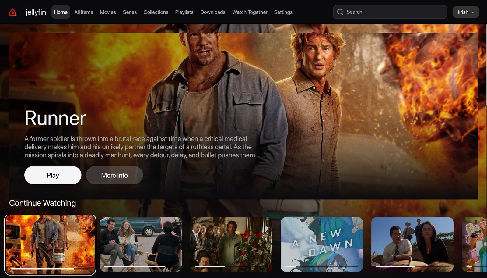
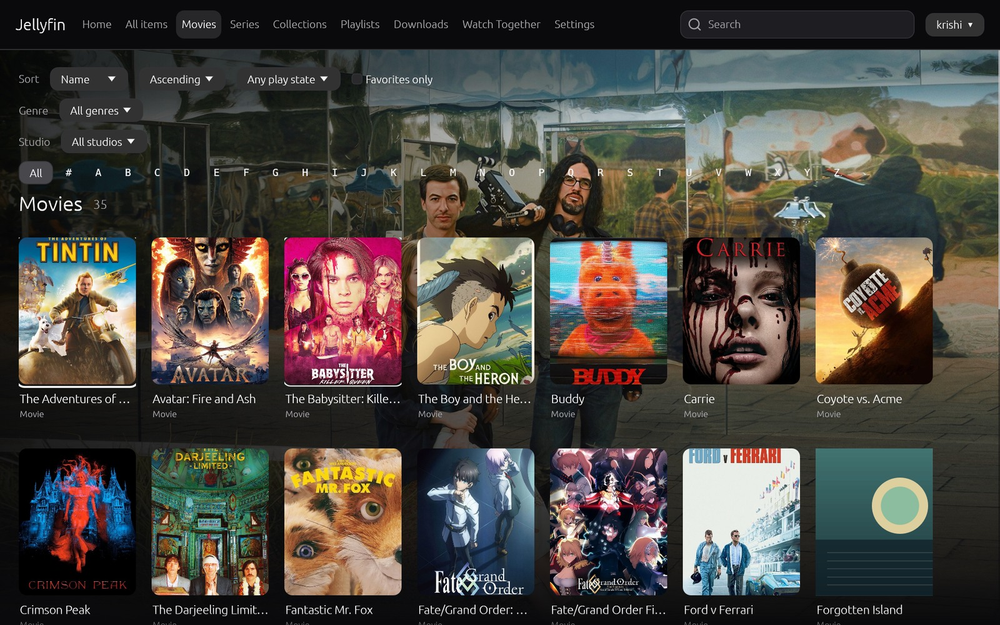
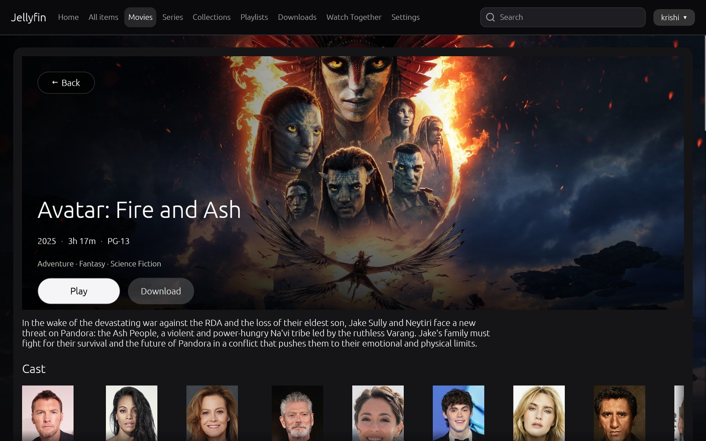

# Jellyfin Kattri

A native desktop client for Jellyfin. Rust, egui and libmpv, with no web view, no
JavaScript UI layer and no server-side changes. Your Jellyfin server stays where it
is; Kattri connects to it like any other client and plays your media in a real
desktop window.



## Why Kattri

- **Native, not a wrapped web app.** The interface is drawn with egui on an OpenGL
  surface, and video is rendered by libmpv into the same window. There is no
  QtWebEngine, no bundled browser and no second UI stack.
- **Your credentials stay in Rust.** libmpv never sees a token or a server URL. It
  plays a loopback relay URL issued per playback, bound to one origin and one
  capability. Remembered sign-ins go to the operating-system credential store, not
  to a settings file.
- **Evidence-based playback.** Kattri probes the local libmpv build and asks the
  server for DirectPlay, DirectStream or Transcode only for formats it can actually
  present. Unsupported sources fall back through the server's transcode path.
- **Built for a TV and a desk.** Hero banners, artwork rows and focus animation,
  driven by keyboard or gamepad as well as the mouse.

## What it does

| Area | Included |
| --- | --- |
| Sign-in | Password sign-in, Quick Connect, saved servers, multiple profiles, stay signed in |
| Home | Continue Watching, Next Up, Latest, My Media and Collections shelves, hero banner |
| Library | Paging, sorting, play-state and favorites filters, 1,000-item photo and poster grids |
| Details | Metadata, overview, cast, similar titles, seasons and episodes with overview and progress, Next Up on series pages, play and download actions |
| Search | Debounced cross-type search grouped by movies, series, episodes, music, playlists, photos, people and channels |
| Playback | Direct play, direct stream and transcode through the relay, resume, playback reporting, audio and subtitle tracks, subtitle delay, chapters, speed control, segment skip |
| Player | Icon control bar with title, time, volume and chapters; previous/next for tracks and episodes, an Up Next card and auto-play of the next episode; media info panel (`I`), equalizer and loudness filters, A-B loop and frame stepping, HDR to SDR tone mapping, refresh-rate matching on Windows, open a stream address |
| Music | Album and playlist browsing, queue with shuffle and repeat, queue restore after restart |
| Live TV | Channel list, 24-hour guide, tune through the relay, record the current program, recordings and scheduled recordings |
| Offline | Download manager with pause, resume, range fallback, checksum verification and external subtitles |
| Extras | Right-click item menu (play, mark watched, favorite, download, add to playlist or queue), playlists, collections, favorites, photos, admin-lite dashboard, parental PIN |
| Settings | General, playback, audio, subtitles, video, input, server, About; versioned TOML per profile |
| Input | Keyboard map, gamepad support (in menus and during playback), full focus navigation, rebindable actions |
| Interface | Standard, Large and TV (10-foot) sizes; choose which home sections appear |

### Library browsing



### Item details



## Platform support

| Platform | Build | Runtime |
| --- | --- | --- |
| Windows x64 | Supported | Exercised: browsing, negotiation, native video presentation |
| Windows ARM64 | Release build and installer scripts | Not exercised on hardware |
| macOS | Universal build scripts and CI build | Not exercised |
| Linux x64 / ARM64 | Packages and CI build | Not exercised |

Playback needs libmpv available to the platform's library loader and a graphical
session. Signed installers and clean-machine installs are not yet part of a release.

## Build from source

Install Rust through rustup; the toolchain is pinned in `rust-toolchain.toml` and
dependencies in `Cargo.lock`.

```sh
cargo build --workspace --locked
cargo run --locked -p egui-gl-host-proof --bin jellyfin-kattri
```

The executable is `jellyfin-kattri`. The optional eframe demo is a UI preview only;
it does not host libmpv.

Linux builds also need pkg-config and libudev development headers for gamepad input:

```sh
sudo apt-get install pkg-config libudev-dev
```

## First run

1. Start the app and enter your server address. Plain HTTP is accepted for loopback
   and private-network addresses; public servers must use HTTPS unless you explicitly
   allow otherwise.
2. Sign in with a password or Quick Connect. Enable "Stay signed in" to keep the
   access token in the OS credential store.
3. Pick a profile with `--profile <name>` to keep separate settings and queues.

Settings and profiles live in the platform config directory. `KATTRI_LOG` overrides
the log level for one run, and the About screen shows the log location. Logs redact
credentials and server addresses; nothing is uploaded anywhere.

## Project status

Kattri is an early development build, not a production release. Public CI is green
on Windows x64/ARM64, macOS, and Linux x64/ARM64. Windows x64 has been exercised
against Jellyfin 12.x for browsing, search, PlaybackInfo, native video rendering,
and authorized stream-only relay playback. A separate Windows RTX 4060 run used
NVDEC and rendered an HDR10 source tone-mapped to SDR. These checks do not establish
complete playback, release readiness, or feature parity with Jellyfin Web/Desktop.

Last visual pass (2026-10-27, Windows x64, real server, stream-only): home, all items,
movies, series, music, photos, playlists, downloads, Live TV, Watch Together and
settings render; an episode played by DirectPlay with hardware decoding (d3d11va) and
WASAPI audio. Fixed in that pass: episode cards without their own image now use the
series poster, the home hero uses a full-resolution series backdrop, and the Series
page lists shows instead of episodes.

### Feature parity with Jellyfin Web

A source-level audit against jellyfin-web (2026-10-27) found large gaps. Kattri is not
yet a replacement for the official clients. The main missing pieces:

- **Item context menu:** right-click (or Shift+F10 / the Menu key on a focused card) on
  library cards, home rows and search results offers Play, Play from beginning, Open details, Go to series, Mark played/unplayed,
  Add/remove favorite, Download, Add to playlist and, for music tracks, Play next and Add
  to queue. Administrators also get Add to collection, Refresh metadata and Delete (with
  a confirmation). Still missing: shuffle from the menu, multi-select and, for
  administrators, edit metadata, identify, edit images and edit subtitles.
- **Episodes and series:** the series page offers the server's Next Up episode (Play or
  Resume), and episode rows show the still, overview, runtime, progress and a watched
  mark.
  In the player, an Up Next card counts down the last 30 seconds of an episode with
  Play now and Cancel. An episode's title opens its own page (Back returns to the
  series) and its ▶ button plays it; rows show the episode's still. Shuffle plays the
  series' episodes in random order, with previous/next and Up Next following that order. The player's previous and next
  buttons move between episodes, and the next episode starts when one ends (a Playback
  setting, on by default).
- **Player OSD:** title, elapsed/total time, transport, chapter stepping, volume with
  mute, frame stepping, A-B loop, speed, PiP and a fullscreen toggle, as a compact
  icon bar, with previous/next for music tracks and episodes and an Up Next card. Still
  missing: trickplay thumbnails on the seek bar and quality/source selection inside the
  player.
- **Library views:** one grid per type with sort, played/favorite and genre filters and
  an alphabet picker. Missing Suggestions, Studios, Collections, Upcoming and Episodes
  tabs and view modes; music can list everything, albums only or songs only, but has no
  artist view; books, home videos and
  music videos have no views.
- **Details pages:** a Media info section lists the source's container, size, bitrate
  and streams; an episode page lists the rest of its season. Missing: version picker,
  extras/special features, trailers, theme media and lyrics.
- **Other:** photos have a slideshow, and the home sections can be turned off one by one
  in General settings, and sign-in has a Forgot password flow. Live TV lists recordings
  (playable) and scheduled recordings (cancellable), and records a channel's current
  program. Missing: series recordings and library management; the dashboard is
  admin-lite.

### Work still required for a production release

**Playback and reliability**

- Validate mid-stream recovery in the running app. A movie or episode that fails after
  it starts now reopens the same source at its last position (then other sources),
  bounded to three reopens; this is unit-tested, not exercised against a real failure.
- Validate the complete graphical path: visible video, audible audio, pause, seek,
  speed, chapters, tracks, subtitles, stop, and clean shutdown.
- Exercise relay replacement in the running graphical host. Unit and software/null
  libmpv replacement-event checks pass, but the full rendered relay flow is unverified.
- Run a long live HLS session. The relay now evicts least-recently-used aliases past
  4,096 instead of refusing (tested with 40,960 rolling segments in unit tests).
- Exercise DirectPlay, DirectStream, and Transcode end to end. Previous server samples
  did not offer DirectStream.
- Validate resume, start/progress/stop reporting, failure reporting, and watched-state
  behavior on an authorized test setup.
- Run disconnect, reconnect, slow-server, stalled-stream, and playback-cancellation
  scenarios.

**Feature integration and acceptance**

- Finish SyncPlay shared-queue playback, ready/buffering reports, queue updates,
  reconnect/error handling, and two-client synchronization acceptance.
- Connect the sandboxed plugin runtime to the app, including load, permission grants,
  run, revoke, unload, and failure handling. Current app runtime fails closed.
- Validate audible music queue advancement, shuffle, repeat, gapless transitions, and
  the 200-track restart/resume scenario.
- Validate tuner-backed Live TV guide data, real channel playback, channel switching,
  reconnects, and tune-time targets.
- Validate the download lifecycle: pause/resume, restart recovery, subtitles, offline
  playback, and low-disk handling.
- Exercise cast and remote control with real devices; mocks do not prove device behavior.
- Validate the admin-lite dashboard with a real administrator account. User counts,
  per-library counts, and scheduled-task summaries are already implemented.
- Verify settings persistence and actual engine/OS effects across profiles, including
  passthrough/PCM fallback, cache, PiP, window memory, screenshots, track memory, and
  subtitle synchronization.
- Complete keyboard, gamepad, and 10-foot navigation walks across menus, dialogs,
  settings, and playback; record screen-reader, focus, and contrast checks per platform.

**Media, hardware, and quality**

- Validate HDR output on HDR-capable hardware per platform. Tone mapping and HDR
  policies exist; HDR passthrough is not proven. Dolby Vision and HDR10+ remain open.
- Validate Windows refresh-rate switching/restoration across fullscreen and monitors;
  Linux/macOS switching remains limited.
- Expand hardware-decode coverage across codecs, drivers, GPUs, and platforms. One
  Windows RTX 4060/NVDEC run has succeeded.
- Validate audio-device switching, equalizer and filters, volume boost, Atmos/DTS:X
  passthrough, and fallback on real equipment.
- Validate ASS/SSA rendering, subtitle styling, secondary subtitles, offset/reset, and
  subtitle synchronization visually.
- Complete or explicitly scope the planned ISO/BDMV/DVD playback support.
- Measure startup, playback startup, scrolling/frame time, texture and resident memory
  against release budgets; complete the eight-hour mixed-use stability soak.

**Distribution and release gates**

- Play with the bundled libmpv on clean Linux and macOS machines. All four platforms
  are now pinned with checksums (Linux x64 and macOS universal from release
  `libmpv-v0.41.0-abe7469`); the AppImage and the Flatpak bundle the pinned build.
- Test Windows x64/ARM64, macOS universal, Linux packages, AppImage, and Flatpak on clean
  systems. All of them now build in CI from the release workflows (2026-10-28: Windows
  MSI and zip for x64 and ARM64, macOS universal, AppImage, deb, rpm and Flatpak).
- 1.0 ships unsigned on Windows (owner decision); complete macOS signing/notarization
  and verify each artifact. The Windows MSI is dual-purpose (per user by default,
  per machine with `ALLUSERS=1`).
- Exercise tag-based packaging, uploads, checksums, and publication on the release head.
- Verify the final embedded SBOM, shipped license notices, and reproducible-build result.
- Review three ignored Linux accessibility dependency advisories and record the release
  decision.
- Choose the release version, verify README build steps on each platform, and publish
  release notes with known gaps.

Discord presence is deferred to 1.1. Automatic update fetching is deferred for 1.0;
the updater signing keyring is empty, so signed automatic updates are unavailable.
Owner approval to use required licenses is recorded; shipped third-party notices and
package-level compliance evidence are still required. Kattri does not guarantee a
feature will work on every device until its platform and hardware checks are recorded.

## Development checks

The default test suite uses local fixtures and an in-process mock Jellyfin server. It
needs no server, no libmpv, no display and no stored credentials.

```sh
cargo fmt --all -- --check
cargo clippy --workspace --all-targets --locked -- -D warnings
cargo test --workspace --locked
```

Run the full gate on Windows with:

```powershell
powershell -NoProfile -ExecutionPolicy Bypass -File scripts/check.ps1
```

or on bash with `bash scripts/check.sh`.

Live-server tests are opt-in and ignored by default. Point them at a test server with
`JELLYFIN_TEST_URL`, `JELLYFIN_TEST_USER` and `JELLYFIN_TEST_PASSWORD`, and read each
test before running it: some perform playback or mutate a disposable playlist. Never
commit credentials, tokens or live output.

## Security and privacy

- Access tokens are zeroized in memory and stored only in the OS credential store,
  bound to the profile, server and exact base address.
- The playback relay listens on loopback only, uses a random capability, enforces the
  upstream origin, refuses redirects and copies only allow-listed response headers.
- JSON, image, manifest and stream inputs are bounded; logs and error messages are
  redacted.
- Remote plain HTTP requires an explicit opt-in. No telemetry is collected.

## License

GPL-3.0-only. See `LICENSE` and `NOTICE`. Bundled native libraries and codecs keep
their own licenses; the libmpv packaging notice is under `packaging/libmpv/NOTICE.txt`.
Jellyfin Kattri is an independent client and is not affiliated with the Jellyfin
project.
